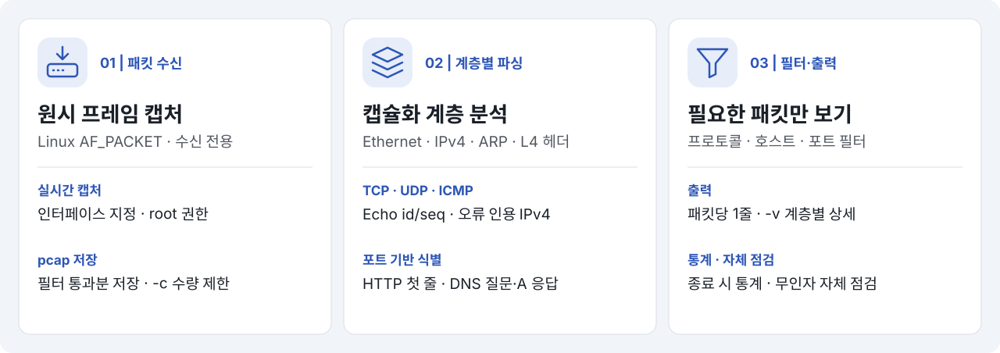
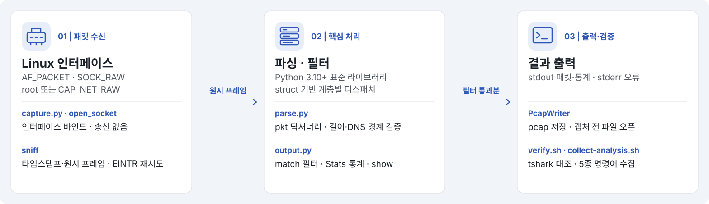

# wirefish


네트워크 프레임의 캡슐화와 계층별 프로토콜을 분석하는 수신 전용 패킷 캡처 CLI·TUI 도구다. Ethernet·IPv4·ARP·TCP·UDP·ICMP 파싱, 포트 기반 HTTP·DNS 식별, pcap 저장, `curses` 기반 3-패널 TUI를 지원한다([소스 구조](docs/03-tech/01-architecture.md#소스-구조)).



## 기술 스택

Python 3.10 이상 표준 라이브러리만 사용하며, 실시간 캡처는 Linux `AF_PACKET/SOCK_RAW` 기반이다([실행 환경과 제약](docs/01-func/01-requirements.md#실행-환경과-제약)).



## 시작하기

루트에서 버전과 무인자 자체 점검을 확인한다(외부 패키지 불필요). 실시간 캡처는 Linux와 root(또는 `CAP_NET_RAW`) 권한이 필요하며 `ip -br link`로 인터페이스를 확인한다.

```bash
python3 -V
python3 src/capture.py
python3 src/capture.py --help
```

## 사용 방법

```bash
sudo python3 src/capture.py -i eth0 -c 50 -v -w capture.pcap
sudo python3 src/capture.py -i eth0 -p tcp --port 80 -c 20
```

| 옵션 | 의미 |
| --- | --- |
| `-i` | 캡처 인터페이스(생략 시 자체 점검만 실행) |
| `-c` | 필터 통과 패킷 수 제한 |
| `-p` | `tcp`, `udp`, `icmp`, `arp` 프로토콜 필터 |
| `--host` | IPv4 송수신 주소, ARP 프로토콜 주소, ICMP 인용 IPv4 주소 필터 |
| `--port` | TCP·UDP 송수신 포트 및 ICMP 인용 포트 필터(생략 시 SSH 22번 제외) |
| `-v` | 계층별 상세 출력(IPv4 `id`, ICMP Echo `id`/`seq`·`[Quoted]`, DNS 전체 hex 포함) |
| `-w` | 필터 통과 패킷의 pcap 저장 경로 |

기본 출력은 패킷당 1줄이며 `Ctrl-C` 종료 시 통계를 출력한다([출력과 오류 처리](docs/01-func/01-requirements.md#출력과-오류-처리)). Linux에서 5종 명령어(`nslookup`·`curl`·`netstat`·`ping`·`traceroute`)의 출력과 캡처·pcap을 일괄 수집할 때는 다음 스크립트를 실행한다(`DNS_TARGET`, `DNS_SERVER`, `HTTP_URL`, `HTTP_HOST`, `PING_TARGET`, `TRACE_TARGET`, `TRACE_HOPS`, `TRACE_PROBES` 환경변수로 대상을 지정할 수 있다).

```bash
./scripts/collect-analysis.sh eth0 /tmp/com-net-analysis-01
```

### TUI 모드

Wireshark 스타일 3-패널(패킷 목록·계층별 상세·Hex/ASCII 덤프) TUI는 Python 표준 `curses`만 사용하며 Linux와 macOS 터미널에서 바로 실행할 수 있다.

```bash
python3 src/tui.py                                  # 샘플 데모 패킷으로 즉시 체험
python3 src/tui.py -r capture.pcap                  # 저장된 pcap 파일 오프라인 분석
sudo python3 src/tui.py -i eth0 -p tcp -w out.pcap  # Linux 실시간 캡처 + pcap 저장
```

| 키 | 동작 |
| --- | --- |
| `↑`/`↓`, `j`/`k`, `PgUp`/`PgDn`, `g`/`G` | 활성 패널 이동·스크롤 |
| `Tab` / `1`·`2`·`3` | 패킷 목록·계층별 상세·Hex/ASCII 패널 포커스 전환 |
| `/` | 화면 내 검색·프로토콜 필터 입력(`Esc` 취소, 빈 입력 해제) |
| `Space` | 실시간 캡처 일시정지·재개 |
| `f` | 최신 패킷 자동 추적(Follow) 토글 |
| `?` / `q` | 단축키 도움말 토글 / 종료(통계 출력) |

## 테스트

일반 사용자 셸에서 실행한다(비-root 캡처 실패도 검증하므로 스크립트 자체를 root로 실행하지 않는다; 상세는 [검증 전략](docs/04-test/01-verification.md#검증-전략)).

```bash
./scripts/verify.sh
python3 src/tui.py --selfcheck
sudo -v && ./scripts/verify.sh eth0
```

## 관련 문서

- [작업 지침](AGENTS.md): 작업 순서와 문서 관리 규칙.
- [3차 과제설명서](docs/3차-과제설명서.pdf): 3차 과제 원본 PDF.

### 문서 분류 기준

<!-- doc-standard:start — doc-standard에서 동기화한다. 이 구간은 직접 고치지 않는다. -->
| 위치 | 담는 내용 |
| --- | --- |
| [`docs/01-func/`](docs/01-func/01-requirements.md) | 범위, 역할별 기능, 업무 정책, 완료 기준 |
| [`docs/03-tech/`](docs/03-tech/01-architecture.md) | 아키텍처, 소스 구조, 데이터 모델, REST/IPC 계약 |
| [`docs/04-test/`](docs/04-test/01-verification.md) | 검증 방법, 판정 기준, 최신 판정과 증거 |
| `docs/` 루트·주제 폴더 | 비명세 자료(과제 안내, 보고서, 발표, 협업 규칙, 자료 수집 기록) |
| 코드 저장소 루트 README | 로컬 설치·실행·테스트 명령 |

API 상세 원본은 OpenAPI·라우터·DTO이며 명세에는 원본 위치와 한계만 적는다. 배포 절차는 `05-ops/`(없으면 기술 명세)에 두고 로컬 실행 명령은 README를 링크한다.
<!-- doc-standard:end -->
